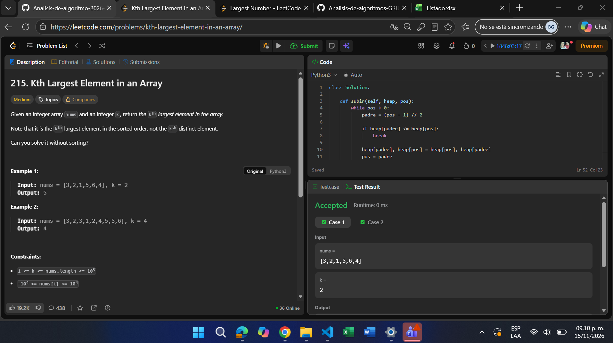
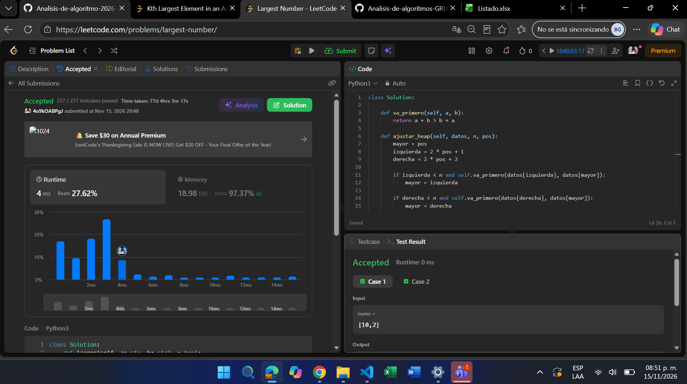
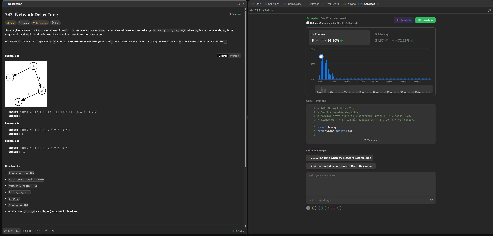
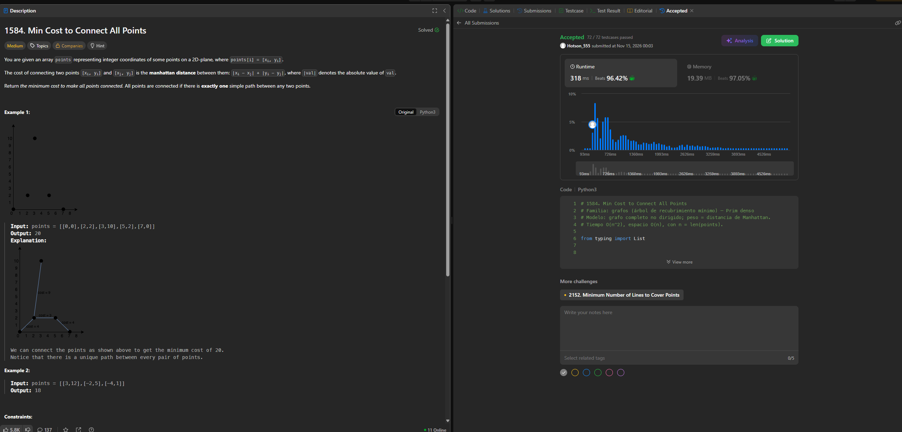
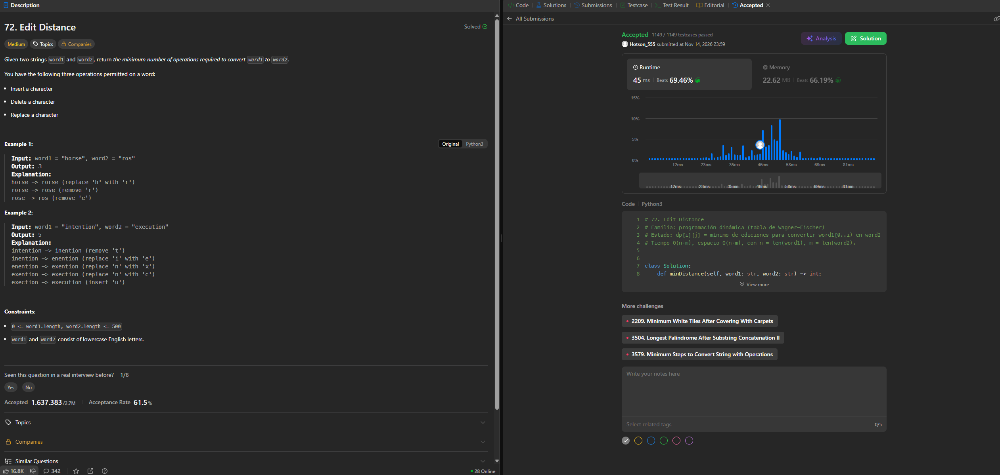

# Taller final — LeetCode por familias

Evaluación de cierre de Análisis de Algoritmos (20 % de la materia). Grupo 14 · ITM · 2026-2.

Integrantes: Sebastián López, Brayan y Miguel.

Ocho problemas Medium de LeetCode de las familias vistas en el curso (heap, ordenamiento, Dijkstra, MST, dos de programación dinámica, greedy y backtracking). Cada integrante es autor, con commit propio, del código de al menos dos. Cada solución tiene su carpeta con el código, una captura del **Submit Accepted** en [`evidencias/`](evidencias/) y una sección en este README con la familia, la idea y la complejidad.

Entrega: sábado 21 de noviembre de 2026, 23:59 (hora de Colombia).

## Autoría

| Integrante | Usuario de git | Usuario de LeetCode | Ejercicios |
| --- | --- | --- | --- |
| Sebastián López | `Sebaslzs` | `Hotson_555` | 743, 1584, 72 |
| Brayan Enríquez | `brayan` | `4o9kOABPgJ` | 215, 179 |
| Miguel | _(usuario)_ | _(usuario)_ | _(pendiente)_ |

## Resumen

| # | Problema | Familia | Autor | Tiempo | Espacio | Estado |
| --- | --- | --- | --- | --- | --- | --- |
| 1 | [215. Kth Largest Element in an Array](#215-kth-largest-element-in-an-array) | Heap | _(pendiente)_ | `O(n log k)` | `O(k)` | ⏳ |
| 2 | [179. Largest Number](#179-largest-number) | Ordenamiento (clave) | _(pendiente)_ | `O(n log n)` | `O(n)` | ⏳ |
| 3 | [743. Network Delay Time](#743-network-delay-time) | Grafos (Dijkstra) | Sebastián López | `O((n + m) log n)` | `O(n + m)` | ✅ |
| 4 | [1584. Min Cost to Connect All Points](#1584-min-cost-to-connect-all-points) | Grafos (MST · Prim) | Sebastián López | `O(n²)` | `O(n)` | ✅ |
| 5 | [72. Edit Distance](#72-edit-distance) | Programación dinámica | Sebastián López | `Θ(n·m)` | `Θ(n·m)` | ✅ |
| 6 | [300. Longest Increasing Subsequence](#300-longest-increasing-subsequence) | Programación dinámica | _(pendiente)_ | `Θ(n²)` | `Θ(n)` | ⏳ |
| 7 | [134. Gas Station](#134-gas-station) | Greedy | _(pendiente)_ | `Θ(n)` | `Θ(1)` | ⏳ |
| 8 | [79. Word Search](#79-word-search) | Backtracking | _(pendiente)_ | `O(m·n·4^L)` | `O(L)` | ⏳ |

## Estructura

```text
ACTIVIDAD #4/
├── README.md
├── kth-largest/                       ← 1 · heap            (pendiente)
├── largest-number/                    ← 2 · clave de orden  (pendiente)
├── network-delay-time/                ← 3 · Dijkstra
├── min-cost-to-connect-all-points/    ← 4 · MST (Prim)
├── edit-distance/                     ← 5 · DP
├── longest-increasing-subsequence/    ← 6 · DP              (pendiente)
├── gas-station/                       ← 7 · greedy          (pendiente)
├── word-search/                       ← 8 · backtracking    (pendiente)
└── evidencias/                        ← capturas *-accepted.png
```

---

## 215. Kth Largest Element in an Array

Enlace: <https://leetcode.com/problems/kth-largest-element-in-an-array/>  
Autor:  Brayan Enríquez (git `brayan`, LeetCode `4o9kOABPgJ`)  
Código: [`kth-largest/solution.py`](kth-largest/solution.py) 
Familia: Heap  
Idea: Se implementó un Min Heap de tamaño k. Durante el recorrido del arreglo se conservan únicamente los k elementos más grandes encontrados hasta el momento. Cuando el heap aún no tiene k elementos, los valores se insertan normalmente. Si ya está lleno, solo se reemplaza la raíz cuando aparece un número mayor. Al finalizar, la raíz del heap corresponde al k-ésimo elemento más grande del arreglo.
Complejidad: Tiempo O(n log k) y espacio O(k).



---

## 179. Largest Number

Enlace: <https://leetcode.com/problems/largest-number/>  
Autor:  Brayan Enríquez (git `brayan`, LeetCode `4o9kOABPgJ`)
Código: [`largest-number/solution.py`](largest-number/solution.py) 
Familia: Ordenamiento (clave por concatenación)  
Idea: El criterio de ordenamiento no se basa en el valor numérico de cada elemento, sino en cuál combinación produce el número más grande al concatenarse. Para dos valores a y b, se compara ab con ba; si ab es mayor, entonces a debe ubicarse antes que b. Con este criterio se construye un heap y posteriormente se aplica Heap Sort para obtener el orden final que forme el número más grande posible.
Complejidad: Tiempo O(n log n · k) donde k es la longitud promedio de los números convertidos a cadena. Espacio O(n) para almacenar la representación en texto de los elementos.




---

## 743. Network Delay Time

Enlace: <https://leetcode.com/problems/network-delay-time/>  
Autor: Sebastián López (git `Sebaslzs`, LeetCode `Hotson_555`)  
Código: [`network-delay-time/solution.py`](network-delay-time/solution.py)  
Familia: grafos (Dijkstra)  
Modelo: grafo **dirigido y ponderado** (pesos ≥ 0); vértices `1 … n`, arco `u → v` con peso `w`.  
Idea: Dijkstra desde `k` con un min-heap de distancia tentativa; se descartan las entradas viejas del heap. La respuesta es la **mayor** distancia finita (hay que esperar al nodo que más tarda); si algún nodo queda en infinito, `-1`.  
Complejidad: con `n` nodos y `m = times.length`, tiempo **`O((n + m) log n)`**, espacio **`O(n + m)`**.



---

## 1584. Min Cost to Connect All Points

Enlace: <https://leetcode.com/problems/min-cost-to-connect-all-points/>  
Autor: Sebastián López (git `Sebaslzs`, LeetCode `Hotson_555`)  
Código: [`min-cost-to-connect-all-points/solution.py`](min-cost-to-connect-all-points/solution.py)  
Familia: grafos (árbol de recubrimiento mínimo) — **Prim**  
Modelo: grafo **completo no dirigido**; peso de la arista = distancia de Manhattan `|x₁ − x₂| + |y₁ − y₂|`.  
Idea: no hay origen; se minimiza la suma de las aristas del árbol que conecta todos los puntos. Prim crece el árbol desde el punto 0 y en cada paso añade el punto de fuera con la arista más barata hacia el árbol (`min_dist`), y luego actualiza `min_dist` con las aristas del punto nuevo.  
Complejidad: con `n = points.length`, Prim denso (sin heap ni lista de aristas) es **`O(n²)`** en tiempo y **`O(n)`** en espacio. (Kruskal sería `O(n² log n)` por ordenar las `Θ(n²)` aristas.)



---

## 72. Edit Distance

Enlace: <https://leetcode.com/problems/edit-distance/>  
Autor: Sebastián López (git `Sebaslzs`, LeetCode `Hotson_555`)  
Código: [`edit-distance/solution.py`](edit-distance/solution.py)  
Familia: programación dinámica (tabla de Wagner–Fischer)  
Estado: `dp[i][j]` = mínimo de ediciones para convertir `word1[0..i)` en `word2[0..j)`.  
Base: `dp[i][0] = i` (borrar `i` letras), `dp[0][j] = j` (insertar `j` letras).  
Recurrencia: si `word1[i−1] == word2[j−1]`, `dp[i][j] = dp[i−1][j−1]`; si no, `dp[i][j] = 1 + min(dp[i−1][j], dp[i][j−1], dp[i−1][j−1])` (borrar, insertar, sustituir). Respuesta: `dp[n][m]`.  
Complejidad: con `n = word1.length` y `m = word2.length`, tiempo **`Θ(n·m)`**, espacio **`Θ(n·m)`**.



---

## 300. Longest Increasing Subsequence

_(pendiente)_

Enlace: <https://leetcode.com/problems/longest-increasing-subsequence/>  
Autor:  
Código:  
Familia: programación dinámica  
Estado / base / recurrencia:  
Complejidad:

---

## 134. Gas Station

_(pendiente)_

Enlace: <https://leetcode.com/problems/gas-station/>  
Autor:  
Código:  
Familia: greedy  
Criterio (qué tramo se descarta y por qué no se vuelve atrás):  
Complejidad:

---

## 79. Word Search

_(pendiente)_

Enlace: <https://leetcode.com/problems/word-search/>  
Autor:  
Código:  
Familia: backtracking  
Qué se elige / qué se deshace:  
Complejidad:
