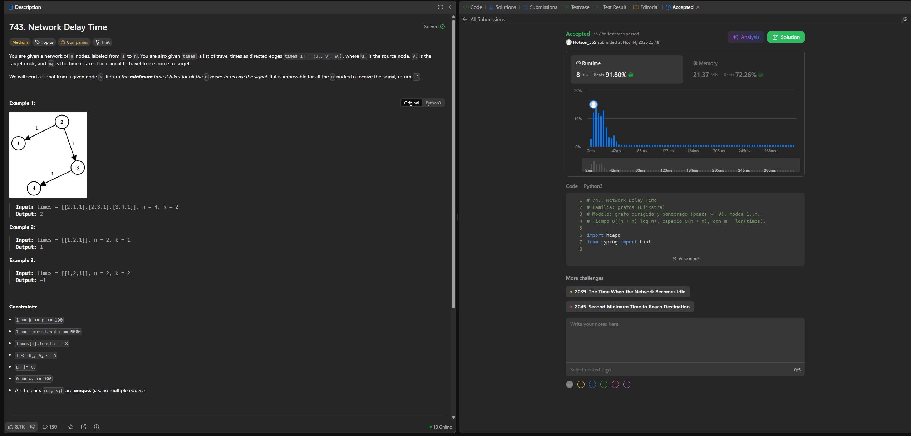
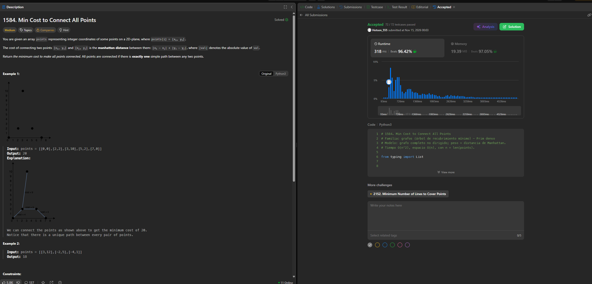
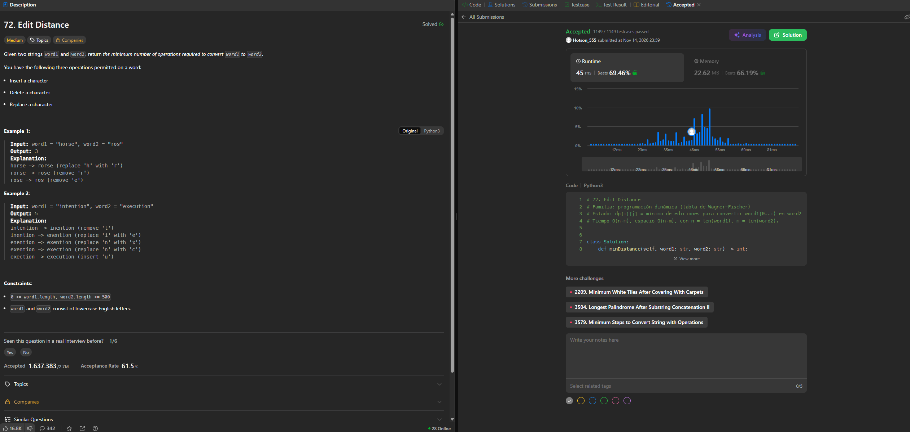

# Taller final · Análisis de algoritmos · ITM 2026-2

| Integrante | Usuario de git | Ejercicios |
| --- | --- | --- |
| _(nombre)_ | _(usuario)_ | 743 |
| _(nombre)_ | _(usuario)_ | 1584 |
| _(nombre)_ | _(usuario)_ | 72 |

> Completar nombres y usuarios. Cada ejercicio lo commitea su autor.

---

## 743. Network Delay Time

Enlace: <https://leetcode.com/problems/network-delay-time/>  
Autor: _(nombre)_ (`usuario`)  
Código: [`network-delay-time/solution.py`](network-delay-time/solution.py)  
Familia: grafos (Dijkstra)  
Modelo: grafo **dirigido y ponderado** (pesos ≥ 0); vértices `1 … n`, arco `u → v` con peso `w`.  
Idea: Dijkstra desde `k` con un min-heap de distancia tentativa; se descartan las entradas viejas del heap. La respuesta es la **mayor** distancia finita (hay que esperar al nodo que más tarda); si algún nodo queda en infinito, `-1`.  
Complejidad: con `n` nodos y `m = times.length`, tiempo **`O((n + m) log n)`**, espacio **`O(n + m)`**.

---

## 1584. Min Cost to Connect All Points

Enlace: <https://leetcode.com/problems/min-cost-to-connect-all-points/>  
Autor: _(nombre)_ (`usuario`)  
Código: [`min-cost-to-connect-all-points/solution.py`](min-cost-to-connect-all-points/solution.py)  
Familia: grafos (árbol de recubrimiento mínimo) — **Prim**  
Modelo: grafo **completo no dirigido**; peso de la arista = distancia de Manhattan `|x₁ − x₂| + |y₁ − y₂|`.  
Idea: no hay origen; se minimiza la suma de las aristas del árbol que conecta todos los puntos. Prim crece el árbol desde el punto 0 y en cada paso añade el punto de fuera con la arista más barata hacia el árbol (`min_dist`), y luego actualiza `min_dist` con las aristas del punto nuevo.  
Complejidad: con `n = points.length`, Prim denso (sin heap ni lista de aristas) es **`O(n²)`** en tiempo y **`O(n)`** en espacio. (Kruskal sería `O(n² log n)` por ordenar las `Θ(n²)` aristas.)

---

## 72. Edit Distance

Enlace: <https://leetcode.com/problems/edit-distance/>  
Autor: _(nombre)_ (`usuario`)  
Código: [`edit-distance/solution.py`](edit-distance/solution.py)  
Familia: programación dinámica (tabla de Wagner–Fischer)  
Estado: `dp[i][j]` = mínimo de ediciones para convertir `word1[0..i)` en `word2[0..j)`.  
Base: `dp[i][0] = i` (borrar `i` letras), `dp[0][j] = j` (insertar `j` letras).  
Recurrencia: si `word1[i−1] == word2[j−1]`, `dp[i][j] = dp[i−1][j−1]`; si no, `dp[i][j] = 1 + min(dp[i−1][j], dp[i][j−1], dp[i−1][j−1])` (borrar, insertar, sustituir). Respuesta: `dp[n][m]`.  
Complejidad: con `n = word1.length` y `m = word2.length`, tiempo **`Θ(n·m)`**, espacio **`Θ(n·m)`**.

